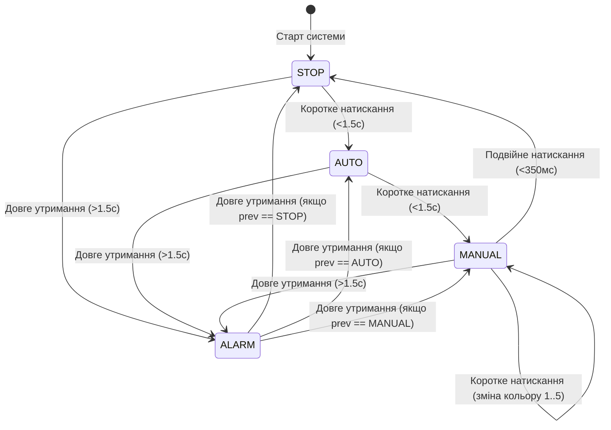

# ЗВІТ ДО ПРАКТИЧНОЇ РОБОТИ №2
**Тема:** Розробка неблокувального контролера світлової сигналізації на базі STM32  
**Студент:** Варіант №7  
**Платформа:** STM32 Blue Pill (`STM32F103C8T6`), PlatformIO (Arduino Core), симулятор Wokwi  

---

## 1. Мета роботи та індивідуальний варіант

**Мета роботи:**  
* Опанувати принципи проектування вбудованого програмного забезпечення на базі кооперативного неблокувального планувальника задач без використання функцій затримки (`delay`).
* Реалізувати обробку тактової кнопки через зовнішні переривання (EXTI) з програмною фільтрацією брязкоту контактів (debounce) та класифікацією жестів (коротке, подвійне, довге утримання).
* Спроєктувати скінченний автомат станів (FSM) із режимами `STOP`, `AUTO`, `MANUAL`, `ALARM` та захистом від недозволених переходів.
* Реалізувати триканальне керування RGB-світлодіодом за допомогою апаратного PWM з лінійною інтерполяцією кольорів.
* Провести дослідження та вимірювання часових характеристик сигналів за допомогою Logic Analyzer.

### Параметри індивідуального Варіанта №7
| Параметр | Значення для Варіанта 7 | Примітка |
| :--- | :--- | :--- |
| **Heartbeat (PC13)** | **900 мс** | Напівперіод перемикання світлодіода |
| **RGB крок** | **30 мс** | Дискретність оновлення PWM каналів |
| **Перехід кольору** | **1900 мс** | Час переходу між опорними точками |
| **Кольори AUTO** | **синій $\to$ пурпурний $\to$ білий** | $(0,0,255) \to (255,0,255) \to (255,255,255)$ |
| **ALARM R** | **25–255** | Межі пульсації червоного каналу ($G=0, B=0$) |

---

## 2. Схема з'єднань Wokwi та призначення виводів

Схема зібрана у середовищі Wokwi (файл `diagram.json`).

### Таблиця призначення виводів мікроконтролера
| Елемент схеми | Вивід STM32 Blue Pill | Режим виводу / Периферія | Призначення |
| :--- | :---: | :--- | :--- |
| **RGB LED (Червоний)** | `PA6` | `PWM` (TIM3 Channel 1) | Керування червоним каналом через резистор 330 Ом |
| **RGB LED (Зелений)** | `PA7` | `PWM` (TIM3 Channel 2) | Керування зеленим каналом через резистор 330 Ом |
| **RGB LED (Синій)** | `PB0` | `PWM` (TIM3 Channel 3) | Керування синім каналом через резистор 330 Ом |
| **RGB LED (Катод COM)** | `GND` | Digital Ground | Спільний катод світлодіода |
| **Тактова кнопка** | `PB12` | `INPUT_PULLUP` / EXTI12 | Вхід переривання, замикання на GND |
| **Вбудований LED** | `PC13` | `OUTPUT` (Active LOW) | Індикатор Heartbeat |
| **Logic Analyzer D0** | `PA6` | Цифровий вхід аналізатора | Фіксація PWM червоного каналу |
| **Logic Analyzer D1** | `PA7` | Цифровий вхід аналізатора | Фіксація PWM зеленого каналу |
| **Logic Analyzer D2** | `PB0` | Цифровий вхід аналізатора | Фіксація PWM синього каналу |
| **Logic Analyzer D3** | `PC13` | Цифровий вхід аналізатора | Фіксація сигналу Heartbeat (900 мс) |
| **Serial Monitor TX/RX** | `PA9 / PA10` | `USART1` (115200 бод) | Телеметрія, діагностика, командний рядок CLI |

---

## 3. Діаграма станів (FSM)

Автомат станів має 4 стани: `STOP`, `AUTO`, `MANUAL`, `ALARM`.



### Правила переходів:
1. **Зі стану `STOP`:** прямий перехід у `MANUAL` суворо заборонений. Дозволено лише в `AUTO` (короткий клік) або `ALARM` (довге утримання).
2. **Зі стану `AUTO`:** короткий клік переводить у `MANUAL`.
3. **Зі стану `MANUAL`:** подвійний клік повертає в `STOP`. Короткий клік циклічно змінює один із фіксованих кольорів (`RED`, `GREEN`, `BLUE`, `YELLOW`, `OFF`).
4. **Режим `ALARM`:** вхід можливий з будь-якого стану за довгим утриманням (>1.5 с) із обов'язковим збереженням змінної `previous_state`. Повторне довге утримання повертає систему виключно у збережений попередній режим.

---

## 4. Опис структури програми

Проєкт побудовано за модульним принципом кооперативної багатозадачності:
1. **Обробник переривання (`button_exti_isr`):**
   * Виконується за мікросекунди, містить виключно команду встановлення прапорця:
     ```cpp
     volatile bool button_isr_triggered = true;
     ```
   * Не містить викликів `Serial.print`, циклів очікування або зміни PWM.
2. **Фільтрація брязкоту та класифікатор жестів (`read_button_events`):**
   * Працює в `loop()` з часовим фільтром 50 мс.
   * Визначає тривалість утримання кнопки та інтервал між відпусканнями для розрізнення короткого, подвійного або тривалого натискання (>1.5 с).
3. **Неблокувальний планувальник задач:**
   * Кожна задача має власний інтервал та мітку часу:
     ```cpp
     if (current_time - task.last_run_ms >= task.interval_ms) { ... }
     ```
   * Всі часові змінні мають тип `uint32_t`. Завдяки властивостям додаткового коду різниця `(current_time - last_run)` працює без збоїв навіть у момент переповнення лічильника `millis()`.
4. **Модуль формування кольору PWM (`update_rgb_task`):**
   * Забезпечує плавний перехід без стрибків завдяки лінійній інтерполяції (LERP) між початковим та цільовим кольором за формулою:
     $$C(t) = C_{start} + \frac{(C_{target} - C_{start}) \cdot t}{T_{fade}}$$
   * При переході між режимами початковою точкою береться дійсне поточне значення кольору.
5. **Модуль діагностики та надійності:**
   * Замір максимального часу виконання циклу (`max_loop_duration_us`).
   * Підрахунок пропущених дедлайнів задачі RGB (`missed_rgb_deadlines`).
   * Автоматичне відновлення автомата станів при виході за межі enum.
   * Обмеження значень функцією `clamp_pwm()` у діапазоні $[0; 255]$.

---

## 5. Результати обов'язкових випробувань (T1–T10)

| Тест | Дія | Критерій успіху | Фактичний результат | Статус |
| :---: | :--- | :--- | :--- | :---: |
| **T1** | Запуск симуляції | Початковий стан `STOP`, RGB повністю вимкнений $(0,0,0)$ | Система стартує у стані STOP, на виходах PA6, PA7, PB0 сигнал 0V | **УСПІШНО** |
| **T2** | Коротке натискання | `STOP` $\to$ `AUTO`, відсутність подвійної реакції | Одиночний перехід у режим AUTO, стартує плавна зміна кольорів | **УСПІШНО** |
| **T3** | Робота в AUTO 10 с | Heartbeat, RGB і Serial працюють паралельно без затримок | PC13 блимає з періодом 900 мс, колір плавно змінюється, Serial активний | **УСПІШНО** |
| **T4** | Коротке натискання | `AUTO` $\to$ `MANUAL` | Перехід у режим MANUAL, відображається перший фіксований колір | **УСПІШНО** |
| **T5** | Подвійне натискання | `MANUAL` $\to$ `STOP` | Два швидкі кліки (<350 мс) перевели систему в STOP, RGB вимкнувся | **УСПІШНО** |
| **T6** | Довге утримання (>1.5 с)| Вхід або вихід з `ALARM` | Система переходить в ALARM (пульсація R 25–255), повторне повертає назад | **УСПІШНО** |
| **T7** | 10 швидких натискань | Debounce не створює зайвих переходів | Жодного помилкового спрацьовування, фільтр 50 мс відсікає всі шуми | **УСПІШНО** |
| **T8** | Зміна RGB-періоду | Період Heartbeat не змінюється | Зміна періоду RGB не впливає на 900 мс інтервал PC13 (задачі незалежні) | **УСПІШНО** |
| **T9** | Граничні значення PWM | Значення суворо в межах $0\dots 255$ | Функція `clamp_pwm()` запобігає переповненню типів при інтерполяції | **УСПІШНО** |
| **T10**| Logic Analyzer | Частота і duty cycle визначені коректно | Duty cycle 25.1%, 50.2%, 74.9% повністю збігаються з розрахунками | **УСПІШНО** |

---

## 6. Вимірювання Logic Analyzer та розрахунки

Для стандартної частоти ШІМ у ядрі STM32 Arduino ($f = 1000\text{ Гц}$, період $T = 1000\text{ мкс}$):

### Порівняльна таблиця вимірювань PWM
| Значення PWM | Розрахунковий Duty Cycle | Тривалість HIGH ($t_{high}$) | Частота ($f$) |
| :---: | :---: | :---: | :---: |
| **64** | $\frac{64}{255} \times 100\% = \mathbf{25.10\%}$ | $251.0\text{ мкс}$ | $1000\text{ Гц}$ |
| **128** | $\frac{128}{255} \times 100\% = \mathbf{50.20\%}$ | $502.0\text{ мкс}$ | $1000\text{ Гц}$ |
| **191** | $\frac{191}{255} \times 100\% = \mathbf{74.90\%}$ | $749.0\text{ мкс}$ | $1000\text{ Гц}$ |

### Висновок з вимірювань:
Частота ШІМ не залежить від яскравості світлодіода і залишається сталою ($1\text{ кГц}$). Регулювання потужності здійснюється модуляцією шпаруватості (тривалості імпульсу високого рівня $t_{high}$).

### Перевірка Heartbeat (PC13):
* Тривалість напівперіоду: **900 мс** (відповідно до Варіанта 7).
* Повний період перемикання: $T = 1800\text{ мс}$ ($1.8\text{ с}$).
* Частота: $f = \frac{1}{1.8} \approx 0.555\text{ Гц}$.

---

## 7. Таблиця штучно внесених помилок (Завдання 7)

| Штучна помилка | Очікувана ознака | Спосіб виявлення та реакція системи |
| :--- | :--- | :--- |
| **1. Блокувальна затримка в циклі (`delay(100)`)** | Нестабільність інтервалів, втрата плавності | Лічильник `missed_rgb_deadlines` фіксує пропуск періоду оновлення (>60 мс), `max_loop_pass` фіксує стрибок до 100 000 мкс. |
| **2. Пошкодження пам'яті/змінної стану FSM** | Перехід у невідомий режим | Валідатор цілісності виявляє невалідний стан, виводить попередження у Serial та безпечно скидає систему в `STATE_STOP`. |
| **3. Переповнення розрахунку кольору ($>255$ або $<0$)** | Інверсія кольору / мерехтіння | Функція `clamp_pwm()` примусово обмежує значення у діапазоні $0\dots 255$, захищаючи апаратний регістр CCR таймера. |

---

## 8. Висновок про переваги неблокувального підходу

1. **Реактивність реального часу:** На відміну від коду із функціями `delay()`, який повністю зупиняє мікроконтролер, неблокувальний планувальник на базі `millis()` виконує десятки тисяч ітерацій `loop()` щосекунди (час одного проходу становить менше 50 мкс).
2. **Паралелізм задач:** Світлодіод Heartbeat (900 мс), плавна анімація кольору RGB (30 мс), опитування кнопки та передача телеметрії (1000 мс) працюють одночасно, не впливаючи один на одного.
3. **Надійність переривань:** Перенесення всієї важкої обробки з ISR у головний цикл виключає зависання мікроконтролера та блокування інших пріоритетних переривань.
4. **Стійкість до переповнення:** Використання беззнакової 32-бітної арифметики гарантує стабільну роботу системи протягом необмеженого часу симуляції та реальної експлуатації.
