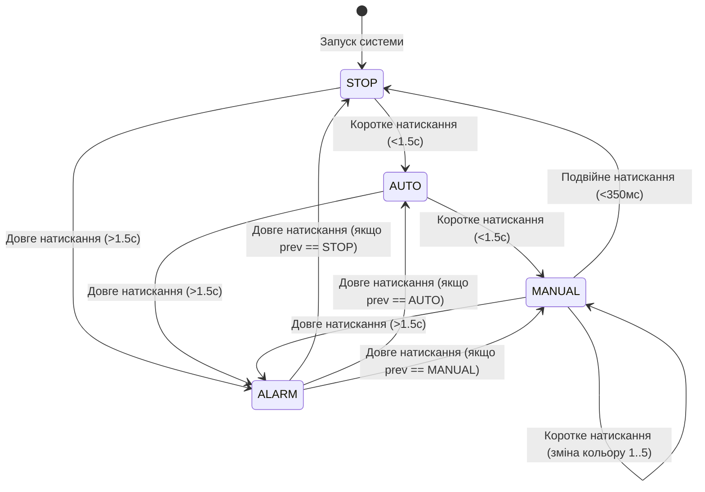

# Завдання 4: Скінченний автомат станів (FSM)

## Мета завдання
Спроєктувати та реалізувати скінченний автомат керування світловою сигналізацією із чотирма режимами: `STOP`, `AUTO`, `MANUAL`, `ALARM`. Реалізувати захист від некоректних прямих переходів та збереження попереднього режиму для відновлення після `ALARM`.

## Діаграма переходів автомата станів

## Правила переходів
1. **Ініціалізація:** Початковий стан `STOP`. Усі PWM-канали RGB вимкнені (0, 0, 0).
2. **STOP $\to$ AUTO:** Коротке натискання кнопки переводить систему в автоматичний режим. Прямий перехід у `MANUAL` заблокований.
3. **AUTO $\to$ MANUAL:** Коротке натискання переводить систему в ручний режим.
4. **MANUAL $\to$ STOP:** Здійснюється виключно за подвійним натисканням. Коротке натискання циклічно змінює один із 5 фіксованих кольорів (`RED`, `GREEN`, `BLUE`, `YELLOW`, `OFF`).
5. **ALARM:** Довге натискання (>1.5 с) із будь-якого стану вмикає `ALARM`, зберігаючи змінну `previous_state`. Повторне довге натискання повертає систему рівно в той робочий режим, який був активний до тривоги.
